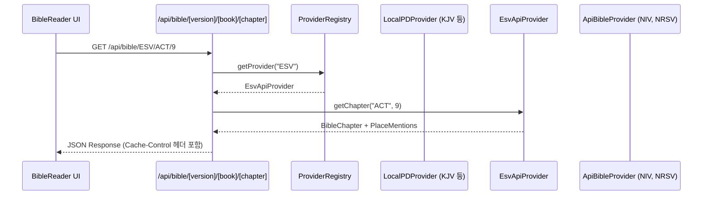

# System Architecture Document: Global Interactive Bible App (PWA)

> **문서 목적**: 이 문서는 Global Interactive Bible App의 기술 스택, 폴더 구조, `BibleProvider` 어댑터 아키텍처, 다국어/세로쓰기/RTL 렌더링 엔진, 인터랙티브 지도 파이프라인을 정의합니다.

---

## 1. 기술 스택 (Tech Stack)

| 계층 | 선택 기술 | 선정 이유 |
| :--- | :--- | :--- |
| **프레임워크** | **Next.js 15 (App Router) + React 19 + TypeScript** | SSR/RSC 기반 빠른 초기 로딩, Route Handlers를 통한 API 키 프록시, 정적/동적 하이브리드 렌더링 |
| **스타일링** | **Tailwind CSS v4** | CSS Logical Properties(`ps-`, `pe-`, `ms-`, `me-`) 네이티브 지원, 다크/세피아 테마 CSS 변수 관리 |
| **다국어 (i18n)** | **next-intl** | 9개 언어 UI 번역, Locale 기반 라우팅 및 RTL/LTR 메타데이터 관리 |
| **상태 관리** | **Zustand** | 가벼운 전역 상태(현재 책/장, 역본, 타이포그래피 설정, 선택된 지명 ID) 관리 |
| **로컬 DB / 오프라인** | **Dexie.js (IndexedDB) + Serwist (PWA)** | 북마크·하이라이트·메모·설정의 브라우저 영구 저장 및 Service Worker 오프라인 캐싱 |
| **지도 엔진** | **MapLibre GL JS + OpenFreeMap (Vector Tiles)** | 완전 무료 오픈소스 벡터 지도, 커스텀 고대 지명 레이어/여정 GeoJSON 오버레이, 부드러운 `flyTo` |
| **모바일 확장 (Phase 2)** | **Capacitor** | 기존 Next.js 웹 앱을 최소 수정으로 iOS/Android 네이티브 앱으로 패키징 |

---

## 2. 권장 프로젝트 디렉터리 구조

```text
bible-atlas-pwa/
├── messages/                      # 9개 언어 UI 번역 JSON (en, ko, ja, zh-Hans, zh-Hant, es, pt, fr, de, ar)
│   ├── en.json
│   ├── ko.json
│   ├── ja.json
│   └── ...
├── public/
│   ├── manifest.json              # PWA 매니페스트
│   └── icons/                     # PWA 앱 아이콘
├── src/
│   ├── app/
│   │   ├── [locale]/              # 다국어 동적 라우트
│   │   │   ├── layout.tsx         # dir="rtl"|"ltr", 폰트, 테마 프로바이더
│   │   │   ├── page.tsx           # 메인 성경 리더 페이지
│   │   │   └── atlas/
│   │   │       └── page.tsx       # 독립 성경 지도(Atlas) & 여정 탐색 페이지
│   │   └── api/
│   │       ├── bible/
│   │       │   └── [version]/[book]/[chapter]/route.ts  # 하이브리드 성경 본문 API 프록시
│   │       └── geo/
│   │           ├── places/route.ts    # 지명 검색 및 상세 해설 API
│   │           └── journeys/route.ts  # 시대별 여정 GeoJSON API
│   ├── components/
│   │   ├── layout/                # Header, Navigation, LanguageSelector, VersionSelector
│   │   ├── reader/                # BibleReader, VerseRenderer, PlaceHighlight, TypographyDrawer
│   │   ├── map/                   # MapPanel, BottomSheetMap, BiblicalMap (MapLibre), PlaceCard, JourneyTimeline
│   │   └── study/                 # BookmarkList, HighlightMenu, NoteEditor
│   ├── data/
│   │   ├── bible-pd/              # 퍼블릭 도메인 성경 JSON (KJV 및 8개 언어 기본 역본)
│   │   └── geo/
│   │       ├── places.json        # 고대↔현대 지명, 좌표, 9개 언어 해설 데이터
│   │       ├── journeys.json      # 출애굽, 바울 선교여행 등 GeoJSON 여정 데이터
│   │       └── verse-places.json  # 성경 장/절별 등장 지명 ID 인덱스
│   ├── lib/
│   │   ├── bible-providers/       # BibleProvider 인터페이스 및 어댑터 구현체
│   │   │   ├── types.ts
│   │   │   ├── registry.ts
│   │   │   ├── local-pd.provider.ts
│   │   │   ├── esv-api.provider.ts
│   │   │   └── api-bible.provider.ts
│   │   ├── db/
│   │   │   └── dexie.ts           # IndexedDB 스키마 및 CRUD 헬퍼
│   │   └── reading-mode.ts        # 언어별 기본 쓰기 방향 및 휠 스크롤 변환 유틸
│   └── store/
│       └── useReaderStore.ts      # Zustand 스토어
├── .env.example
└── next.config.ts
```

---

## 3. 하이브리드 성경 데이터 어댑터 (`BibleProvider`)

저작권 보호 역본(**NIV, ESV, NRSV**)과 퍼블릭 도메인 역본(**KJV** 및 8개 언어 기본 역본)을 하나의 일관된 인터페이스로 처리하기 위해 **어댑터 패턴**을 사용합니다.

### 3.1 핵심 아키텍처 원칙
1. **API 키 보안**: `ESV_API_KEY`, `API_BIBLE_KEY`는 오직 서버 사이드(Next.js Route Handlers `/api/bible/...`)에서만 사용하며 클라이언트에 절대 노출하지 않습니다.
2. **저작권 캐시 제어 (`allowOfflineCache`)**:
   - `LocalPublicDomainProvider` (KJV 등): `allowOfflineCache: true` → 클라이언트 IndexedDB 및 Service Worker에 영구 캐시 허용.
   - `EsvApiProvider` / `ApiBibleProvider`: `allowOfflineCache: false` → 메모리/단기 세션 캐시만 사용하고 영구 오프라인 저장 차단.
3. **우아한 폴백 (Graceful Fallback)**: 개발 환경이나 API 키가 설정되지 않은 상태에서 사용자가 `NIV/ESV/NRSV`를 선택하면, 명확한 안내 메시지("API 키 설정 필요")와 함께 `KJV`로 즉시 전환할 수 있는 버튼을 제공합니다.

### 3.2 어댑터 레지스트리 흐름



---

## 4. 다국어 읽기 방향 & 타이포그래피 엔진

### 4.1 CSS Logical Properties 강제 규칙
아랍어(`ar`, `dir="rtl"`) 지원 시 UI가 깨지지 않도록 **물리적 방향 클래스 사용을 금지**하고 논리적 방향 클래스만 사용합니다:
- ❌ 금지: `ml-4`, `mr-2`, `pl-4`, `pr-2`, `left-0`, `right-0`, `text-left`, `border-l`
- ✅ 필수: `ms-4`, `me-2`, `ps-4`, `pe-2`, `start-0`, `end-0`, `text-start`, `border-s`

### 4.2 일본어·번체 세로쓰기 (`vertical-rl`) 구현 스펙
세로쓰기(`writingMode === 'vertical-rl'`) 활성화 시 컨테이너에 다음 CSS를 적용합니다:

```css
.reader-vertical-rl {
  writing-mode: vertical-rl;
  text-orientation: mixed;
  overflow-x: auto;
  overflow-y: hidden;
  height: calc(100dvh - 8rem); /* 뷰포트 높이에 맞춰 세로 줄바꿈 */
  width: 100%;
  padding-block: 1.5rem;
  padding-inline: 2rem;
  line-break: strict;
  word-break: normal;
}

/* 세로쓰기 내 절 번호(1, 2, 12 등) 가로 조합 */
.reader-vertical-rl .verse-number {
  text-combine-upright: digits 2;
  font-size: 0.75em;
  margin-block-end: 0.35em;
  font-variant-numeric: tabular-nums;
}
```

- **마우스 휠 가로 스크롤 변환**: 데스크톱 사용자가 세로쓰기 모드에서 마우스 휠을 아래로 굴릴 때(`e.deltaY > 0`), `vertical-rl`은 오른쪽에서 왼쪽으로 읽으므로 `container.scrollLeft -= e.deltaY`로 변환하여 자연스럽게 다음 줄로 이동하도록 커스텀 훅(`useVerticalWheelScroll`)을 구현합니다.

### 4.3 9개 언어 웹폰트 전략
`next/font/google`을 통해 기본 라틴/한글/아랍어/일본어/중국어 폰트를 로드합니다:
- **영어/유럽어 (`en, es, pt, fr, de`)**: `Noto Serif` (본문), `Inter` (UI)
- **한국어 (`ko`)**: `Noto Serif KR` (본문), `Noto Sans KR` (UI)
- **일본어 (`ja`)**: `Shippori Mincho` 또는 `Noto Serif JP` (세로쓰기 가독성 우수)
- **중국어 (`zh-Hans`, `zh-Hant`)**: `Noto Serif SC` / `Noto Serif TC`
- **아랍어 (`ar`)**: `Amiri` (아랍어 성경/고전 타이포그래피 최적화) + `Noto Sans Arabic` (UI)

---

## 5. 인터랙티브 지도 및 지명 매칭 파이프라인

### 5.1 언어 독립적 지명 태깅 전략 (`VersePlaceIndex`)
9개 언어 본문 텍스트에서 정규식으로 지명을 찾으면 번역어 차이(예: `Damascus`, `다메섹`, `ダマスコ`, `دمشق`) 때문에 유지보수가 어렵습니다. 대신 **2단계 하이브리드 매칭**을 사용합니다:
1. **구절 단위 인덱스 (`verse-places.json`)**: `ACT.9.3` (사도행전 9장 3절)에 등장하는 지명 ID 목록(`["damascus"]`)을 사전 매핑합니다.
2. **다국어 별칭 매칭 (`places.json`의 `aliases[locale]`)**: 해당 절 텍스트를 렌더링할 때, 그 절에 연결된 지명 ID들의 현재 언어 별칭(예: `ko` → `["다메섹", "다마스쿠스"]`)을 찾아 `<PlaceHighlight placeId="damascus">` 컴포넌트로 감쌉니다.
3. 만약 본문 문자열 매칭이 미세하게 어긋나는 번역본(예: 대명사 처리)이더라도, 절 번호 옆에 작은 `📍 지명 배지`를 함께 표시해 사용자가 항상 해당 절의 지명을 클릭해 지도를 열 수 있도록 보장합니다.

### 5.2 MapLibre GL JS 벡터 지도 구성
- **타일 소스**: API 키가 필요 없는 `https://tiles.openfreemap.org/styles/liberty` (또는 `positron`) 스타일을 기본으로 사용.
- **고대 ↔ 현대 레이어**:
  - 기본 지도는 현대 국가 경계, 지형(산맥·강·사막), 현대 도시명을 표시.
  - GeoJSON Source로 성경 지명 포인트(`places.json`)와 시대별 여정 라인(`journeys.json`)을 오버레이.
  - 지명 선택 시 `map.flyTo({ center: [lng, lat], zoom: 8, essential: true })` 실행 및 선택 마커 펄스 애니메이션 표시.

---

## 6. PWA 오프라인 & 보안 고려사항
- **Service Worker (Serwist)**: 앱 셸(App Shell), UI 번역 JSON, 퍼블릭 도메인 성경 데이터(`/data/bible-pd/*`), 지리 데이터(`places.json`, `journeys.json`)를 프리캐시/런타임 캐시합니다.
- **입력 검증 및 XSS 방지**: 외부 API에서 받은 성경 본문 HTML/텍스트는 반드시 정제(Sanitize)하거나 순수 텍스트/구조화 토큰으로 파싱하여 렌더링합니다.
